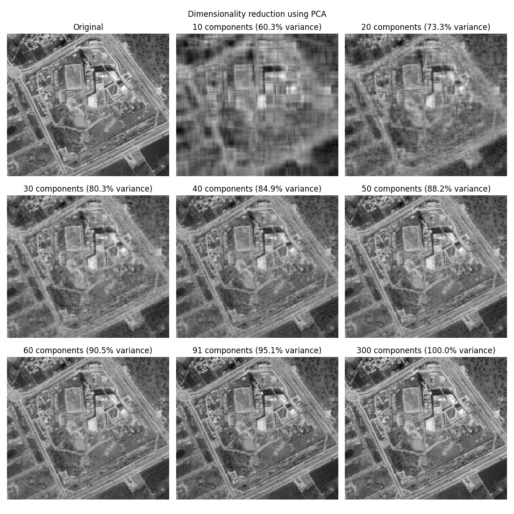
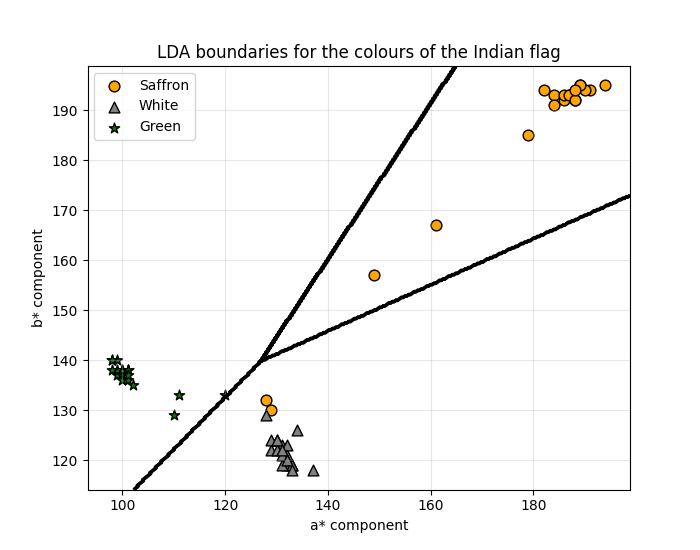
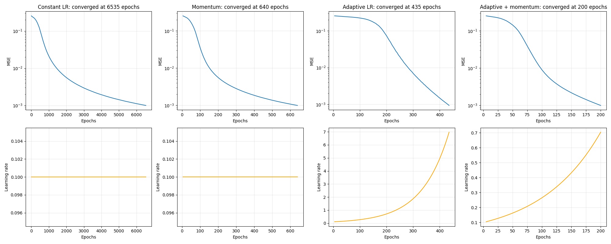

# Machine Learning and Pattern Recognition Labs

Lab notebooks (Lab 5 is on its own branch) covering classic machine learning and the basics of neural networks: image features, clustering, PCA, LDA, k-NN, SVM, semi-supervised learning, text classification, the perceptron, backpropagation and CNNs. Each notebook is saved with its outputs and ends with my answers to the lab's report questions.

## Coursework

Labs for **Machine Learning and Pattern Recognition (MLPR)**, Semester 4 (Spring 2025), Plaksha University.

## Labs and results

| Lab | Notebook | Topic | Result |
|---|---|---|---|
| 1 | `lab01_chromosome_features.ipynb` | Contours and shape features of chromosomes (OpenCV), standardisation vs normalisation | Height, width, area, perimeter and circularity per contour |
| 2 | `lab02_kmeans_elbow.ipynb` | K-Means and the elbow method on 4 Gaussian clusters | The elbow correctly picks K = 4 |
| 3 | `lab03_pca_from_scratch.ipynb` | PCA with NumPy only, applied to compress a satellite image | 91 of 300 components keep 95% of the variance |
| 4 | `lab04_flag_colours_lda.ipynb` | Indian flag colours in CIELAB space, separated with LDA | 58 of 60 hand-picked points classified correctly |
| 5 | on branch `lab05-original-submission` | Haar-cascade face detection, K-Means on hue and saturation, nearest-centroid classification of a new face | Kept as originally submitted; see below |
| 6 | `lab06_knn_movie_genres.ipynb` | k-NN for Action vs Drama movies, k from 1 to 499 | Best k = 69: accuracy 80.3%, F1 0.80 |
| 7 | `lab07_svm_cricket.ipynb` | SVM with a polynomial kernel predicting the format of Virat Kohli's innings | 68.9% accuracy (3 classes), plus a degree sweep showing over- and underfitting |
| 8 | `lab08_semi_supervised.ipynb` | Self-training k-NN with 200 labelled and 2,000 unlabelled points | 89.2% accuracy on the unlabelled points |
| 9 | `lab09_text_classification.ipynb` | NLTK preprocessing, TF-IDF and Random Forest on factory reports | 91.7% accuracy across 4 failure categories |
| 10 | `lab10_perceptron.ipynb` | Perceptron from scratch with the perceptron learning rule | Converges in 4 epochs, 100% test accuracy |
| 11 | `lab11_xor_backprop.ipynb` | 2-8-1 network for XOR: constant learning rate vs momentum vs adaptive learning rate | 6,535 epochs (constant) vs 200 (adaptive + momentum) to reach MSE < 0.001 |
| 12 | `lab12_fertility_backprop.ipynb` | Backpropagation from scratch on the UCI Fertility data, 1 to 9 hidden neurons | Training MSE falls to 0.05, test MSE 0.085-0.124 |
| 13 | `lab13_mnist_cnn.ipynb` | CNN in TensorFlow/Keras on MNIST digits | 99.06% test accuracy after 5 epochs |







## Data

All datasets are in `data/`, except MNIST, which Keras downloads automatically. The UCI Fertility dataset was added from the UCI repository, because the original file was uploaded to Colab and not kept. The points for Lab 4 (`flag_points.csv`) are the 60 points I clicked by hand in the original submission, recovered from its saved output so the notebook runs without a mouse.

## How to run

```
pip install -r requirements.txt
jupyter notebook
```

## Notes on the cleanup

- Hard-coded paths such as `C:\sem4\MLPR\...` were replaced with `data/`, and duplicate drafts were merged into one notebook per lab.
- Lab 3 now gets the explained variance from its own eigenvalues instead of `sklearn.decomposition.PCA`, which the lab did not allow.
- Lab 4 can still be run interactively (`INTERACTIVE = True`), but by default it uses the saved points.
- Lab 7 now standardises the features before the polynomial-kernel SVM. On raw runs and strike rates the solver took more than ten minutes to converge.
- Lab 9's confusion matrix used labels in the wrong order (`set(y)`). It now uses the classifier's class order.
- Labs 11 and 12 had a training loop with no upper limit and several duplicated cells. These were tidied up.
- Lab 14 (ResNet50 and SVM on Indian currency notes) is not included: the submission was never completed and the dataset is not available.

## Lab 5

Lab 5 (distance-based classification) is not on the main branch. It is kept as I originally submitted it in February 2025, with its original commit history, on the [`lab05-original-submission`](../../tree/lab05-original-submission) branch and in its own repository, [distance_classification](https://github.com/PrashamSheth/distance_classification).
